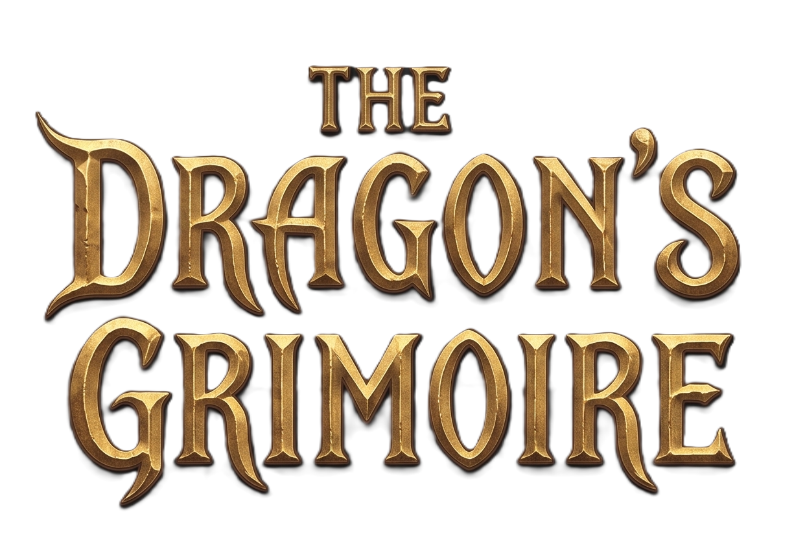

# The Dragon´s Grimoire - Proyecto Web Final 

The Dragon's Grimoire nació como un proyecto universitario el solicitaba una plataforma web full-stack desarrollada para la creacion de mazos y gestion de colecciones del juego tcg Magic the Gathering.

## Herramientas utilizadas
* ** Backend:** Django Rest Frameworl, Python, SQLite.
* **Frontend:** React, Vite, JavaScript.